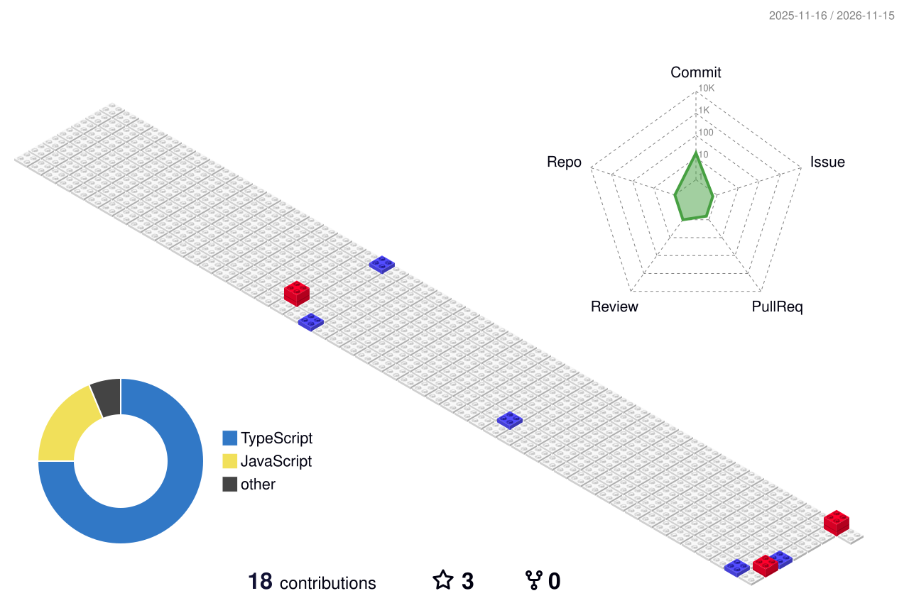

📫 How to reach me **win78py@gmail.com**

Backend engineer working mainly in **Go** — event-driven services, CDC pipelines and real-time fanout on a sales platform.

#### Core — Go

#### Event Streaming & CDC

#### Data

#### Platform & Tooling

#### Also work with

 

 

<!--
Stash — badges kept for later:

Note: shields.io no longer ships logos for grpc, protobuf, debezium, aws and
vscode (brand removals in simple-icons) — those badges are text-only on purpose.
-->
